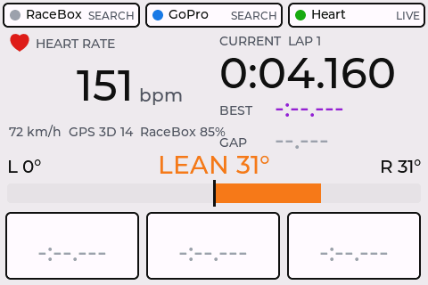
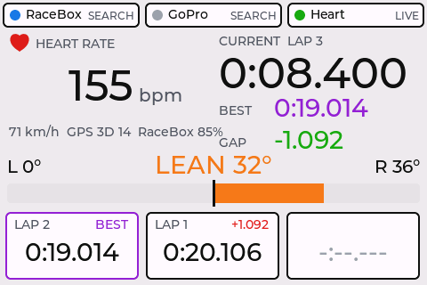

# Dashboard_Moto: lap timer and lean-angle dash

ESP-IDF firmware for a motorcycle track-day dash on a 3.5" 480x320 colour LCD. It shows:

- **Lean angle** from a [RaceBox Micro](https://www.racebox.pro/) (flat bar, left/right, with the maximum on each side)
- **Heart rate** from any standard BLE heart-rate strap
- **Lap timing**: current lap, best lap, the gap of the last lap against the best, and the last 3 laps
- **Status of every Bluetooth device** (RaceBox, GoPro, heart-rate strap) on screen and on a NeoPixel bar
- **GoPro and RaceBox control** from external buttons (shutter, mode, sleep, RaceBox recording)

There is no touch input: everything is driven by external buttons.

It builds for two boards from the same source:

| Board | Chip | Display |
|---|---|---|
| Freenove FNK0103N 3.5" | ESP32 | ST7796, 320x480 (used in landscape) |
| Waveshare ESP32-S3-Touch-LCD-3.5 | ESP32-S3 | ST7796, 320x480 (used in landscape) |

## Screenshots

These were captured from the real display on the Waveshare board, running [demo mode](#demo-mode).

**First lap in progress** (no lap finished yet):



**Third lap, with two finished laps and the gap against the best** (green: faster than the best lap):



## What is on screen

| Area | Content |
|---|---|
| Top row | One chip per Bluetooth device: RaceBox, GoPro, Heart. A dot and a state word (SEARCH, LINK, READY, REC, PAUSED, LOCKED, PAIRING, LIVE; the GoPro chip shows its mode, Video / Photo / Timelapse, once ready). The dot blinks while searching. |
| Left | Heart rate in bpm (grey `--` with "NO STRAP" until a strap connects), then speed, GPS fix and satellite count, and RaceBox battery. |
| Right | Current lap time and lap number, best lap in purple, and the gap: last lap minus the best lap before it (green if faster, red if slower). |
| Lean bar | Flat bar centred on zero, growing left or right (range +-60 degrees). Green below 30 degrees, orange up to 45, red above. The maximum left and right lean of the session sit at each end. |
| Bottom | The last 3 laps with their delta to the best. The best lap has a purple outline. |

When there is no start line yet the lap caption turns red ("NO START LINE - PRESS MARK").

## Hardware and pinouts

### Display

| Signal | Freenove FNK0103N (ESP32) | Waveshare S3-Touch-LCD-3.5 (ESP32-S3) |
|---|---|---|
| MOSI | GPIO 13 | GPIO 1 |
| MISO | GPIO 12 | not connected |
| SCLK | GPIO 14 | GPIO 5 |
| CS | GPIO 15 | tied low on the board |
| DC | GPIO 2 | GPIO 3 |
| Backlight (PWM) | GPIO 27 | GPIO 6 |
| Reset | not used | TCA9554 I/O expander, EXIO1 (I2C SDA 8, SCL 7) |
| Colour inversion | off | on |

The pins come from the Freenove TFT_eSPI setup files and from Waveshare's own ESP-IDF example. Orientation is set by `LCD_MIRROR_X` / `LCD_MIRROR_Y` in [`main/display.h`](main/display.h). Backlight level is `LCD_BRIGHTNESS_PCT`, and `display_set_brightness()` changes it at runtime.

### Buttons

Each button goes between its GPIO and GND (internal pull-ups are used; GPIO 35 on the ESP32 has none, so it needs an external 10 k to 3V3).

| Function | Freenove (ESP32) | Waveshare (ESP32-S3) |
|---|---|---|
| RaceBox recording on/off | GPIO 16 | GPIO 38 |
| GoPro shutter | GPIO 22 | GPIO 39 |
| GoPro mode (Video / Photo / Timelapse) | GPIO 21 | GPIO 40 |
| GoPro power (sleep) | GPIO 35 | GPIO 41 |
| Mark start/finish line | GPIO 17 | GPIO 42 |

The mark button: a short press stores the start/finish line at the current position and heading (it needs a GPS fix and some speed). Holding it for 1.5 s resets the laps and the maximum lean.

These pins were chosen from the header pinouts of each board. Check them against your wiring; they are all in [`main/config.h`](main/config.h).

### NeoPixel status bar

| Board | Data pin |
|---|---|
| Freenove (ESP32) | GPIO 4 |
| Waveshare (ESP32-S3) | GPIO 21 |

A WS2812 chain of 10 pixels (`kRgbLedCount` in `config.h`):

| Pixel | Shows | Colours |
|---|---|---|
| 0 | RaceBox | blue slow blink: searching; cyan fast blink: connecting; green: connected; red: recording; orange blink: recording paused; purple blink: memory locked |
| 1 | GoPro | blue blink: searching; yellow: pairing; green: ready; red blink: recording |
| 2 | Heart-rate strap | blue slow blink: searching; green: connected |
| 3-9 | Last lap result, for 2 s | purple: new best; green: faster than the previous lap; red: slower; cyan: first lap |

## Bluetooth devices

The dash is a BLE central only (it never advertises) and keeps three connections at once using NimBLE:

- **RaceBox Micro**: found by its name prefix. It streams GPS, acceleration and rotation at 25 Hz.
- **GoPro**: found by service 0xFEA6 and bonded with Just Works legacy pairing. Put the camera in pairing mode once; the bond is saved.
- **Heart-rate strap**: any strap with the standard Heart Rate service (0x180D), no pairing needed.

The dash connects to the first matching device it sees; it does not pin a specific one. See the [security review](docs/security-review.pdf) for what that means and how to fix it.

## How the numbers are computed

- **Lean angle.** The RaceBox does not report lean. The dash blends the gyro roll rate with a reference taken from lateral acceleration (speed x yaw rate), because a rider keeps the resultant force along the bike's vertical axis and the accelerometer alone reads about zero in a corner. Below about 15 km/h it uses the accelerometer's tilt instead. It assumes the RaceBox is mounted flat and facing forward. If left and right are swapped, flip `kRollRateSign`, `kYawRateSign` and `kAccelRollSign` in `config.h`.
- **Laps.** The start/finish line is a point and a heading, stored in flash. A lap is counted when the GPS track crosses the line in the direction of travel, with the crossing time interpolated between two GPS samples. Crossings within 15 s of each other, below about 18 km/h, or more than 30 m from the line's centre are ignored.
- **Gap.** The last lap minus the best lap before it. It stays empty after the first lap.

This is an estimate, not a calibrated measurement: check it against a reference before relying on it.

## Demo mode

`kDemoTelemetry` in [`main/config.h`](main/config.h) is `true` by default. In demo mode a simulated bike laps a 64 m radius circle, about 20 s per lap with the speed varying lap to lap. The line is marked automatically at the start, so laps, gap, lean (about 32 to 36 degrees) and a simulated heart rate appear without any hardware attached. The Bluetooth chips and the NeoPixels still show the real state of the real devices.

The screenshots above were taken in demo mode.

To use real data, set `kDemoTelemetry` to `false` and reflash.

## Build and flash

Needs ESP-IDF 5.5 (built and tested with 5.5.4). The first build downloads LVGL 9, the ST7796 driver and `led_strip` from the component registry.

**Freenove FNK0103N (ESP32):**

```bash
idf.py set-target esp32
idf.py -p COM3 flash monitor
```

**Waveshare ESP32-S3-Touch-LCD-3.5:** this uses a separate build folder and config file so the two targets do not disturb each other.

```bash
idf.py -B build_s3 -D SDKCONFIG=sdkconfig.s3 set-target esp32s3
idf.py -B build_s3 -D SDKCONFIG=sdkconfig.s3 -p COM17 flash monitor
```

Change the COM port to match your board. The VS Code ESP-IDF extension works with the project folder as is.

## Project layout

| Path | Purpose |
|---|---|
| `main/main.cpp` | Start-up and the LVGL loop |
| `main/display.c/.h` | LVGL and ST7796 setup, pins, backlight (both boards) |
| `main/ui.cpp` | The dashboard screen |
| `main/telemetry.cpp/.h` | Lean estimate and GPS lap timing (no ESP-IDF dependency) |
| `main/racebox_ble.cpp`, `ubx_protocol.*` | RaceBox connection, UBX parsing, data message |
| `main/gopro_ble.c`, `gopro_control.c` | GoPro connection and commands |
| `main/heart_rate_ble.c` | Heart-rate strap |
| `main/ble_manager.cpp` | NimBLE host and the shared scan |
| `main/buttons.cpp` | Button handling |
| `main/status_led.cpp` | NeoPixel bar |
| `main/line_store.cpp` | Start/finish line saved in flash |
| `main/demo.cpp` | Demo mode |
| `main/config.h` | Pins and settings |
| `sdkconfig.defaults*` | Shared, ESP32 and ESP32-S3 settings |
| `docs/security-review.pdf` | Firmware security review with remediation |

## Status and limits

- The lap and lean logic was checked on the board with the demo track (lap time and lean angle matched the simulated values). It has not yet been tested on a bike with a real RaceBox, GoPro or strap.
- Touch, IMU, camera, SD card and audio on the Waveshare board are not used.
- The Bluetooth peers are not pinned: the dash connects to the first match.

## Credits

The BLE, GoPro and RaceBox code comes from the earlier ESP32-C6 firmware on this repository's `main` branch.
